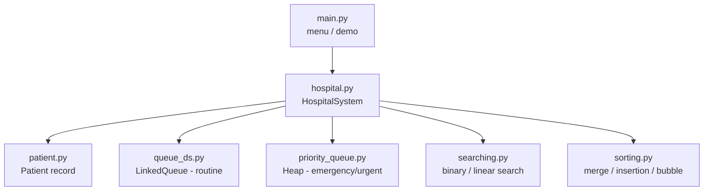
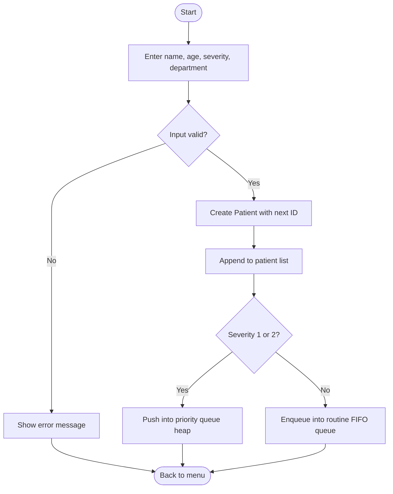
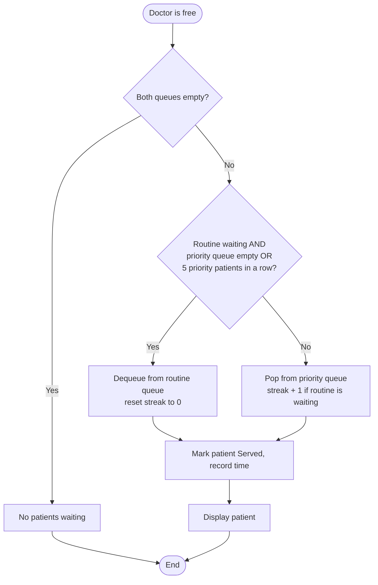

# Architecture

## Module layout

## Flowchart: registering a patient

## Flowchart: calling the next patient

## Data structure decisions

| Need | Structure chosen | Reason |
|---|---|---|
| Serve urgent cases first, FIFO among equals | Binary min-heap, key `(severity, id)` | O(log n) insert and remove |
| Serve routine cases in arrival order | Linked-list queue | O(1) enqueue and dequeue |
| Keep all patient details | List sorted by ID | Allows binary search and easy reporting |
| Find by ID | Binary search | O(log n) on the sorted list |
| Reports sorted by any field | Merge sort (default) | O(n log n), stable |

## Clock handling

`HospitalSystem` takes a `clock` function that returns the current time in minutes. The menu program uses the real clock. The demo and the unit tests use `SimulatedClock`, which lets time be advanced instantly so waiting times can be shown and tested without actually waiting.
